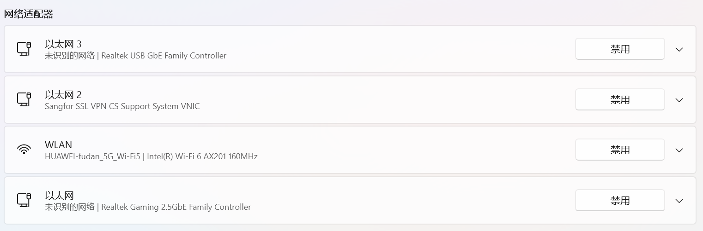
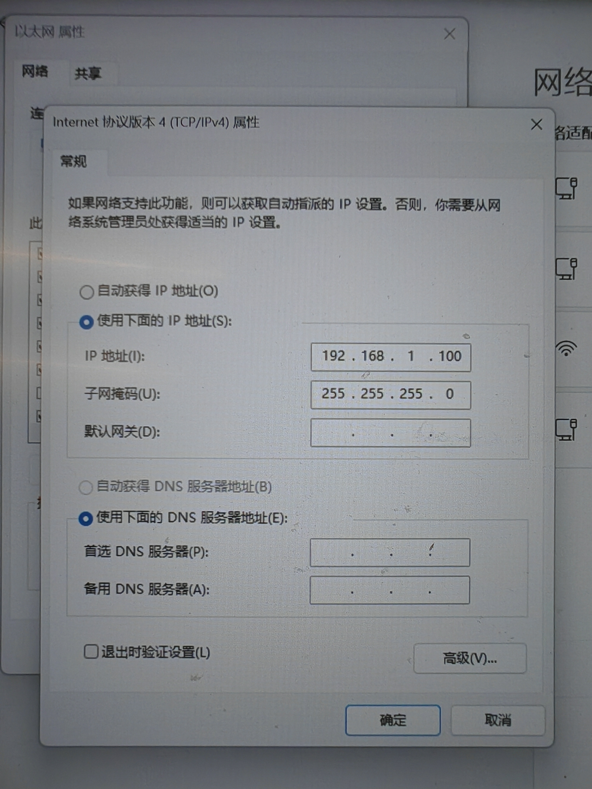
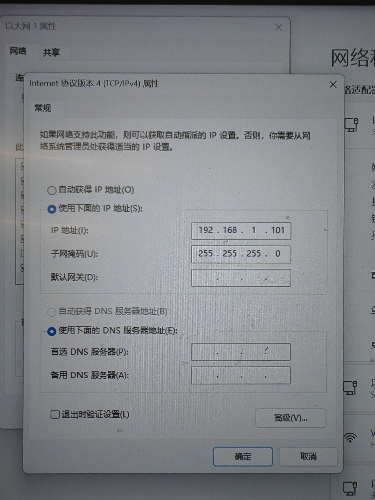

# 机械臂与电脑网络配置

## 1. 配置机械臂和 Windows 网卡

两台机械臂分别设为 `192.168.1.18` 和 `192.168.1.19`（机械臂ip可以通过示教器界面更改）。

电脑通过两根网线连接机械臂时，确认 Windows 中有两个对应的物理网卡（如图中的“以太网”和“以太网3”）：



分别按图配置两个网卡的 IPv4 地址。网卡地址必须与实际接线对应，并与机械臂处于同一网段：




## 2. 配置 WSL 到机械臂的路由

在 WSL 中查询两台机械臂各自使用的网卡和本机地址：

```bash
ip route get 192.168.1.18
ip route get 192.168.1.19
```

核对输出中的 `dev` 和 `src` 与接线、网卡地址相符。两张网卡配置在同一网段时，普通路由可能把两台机械臂都选到同一张网卡，需要为机械臂地址添加 `/32` 主机路由。Windows 网卡顺序、WSL 接口名和机械臂接线映射都可能变化，不能只凭历史上的 `.18`/`.19` 与 `.100`/`.101` 对应关系配置。

WSL 的 `ethX` 名称可能在重启或网卡重新枚举后变化。例如本机曾从 `eth0=.101、eth1=.100` 变为 `eth0=.100、eth3=.101`。脚本会按源 IP 查当前接口，因此接口改名本身不需要改脚本；但机械臂 IP 到本机源 IP 的对应关系必须按当前接线重新确认。

先在 Windows PowerShell 分别测试两台机械臂的 TCP 端口，记录每次输出的 `InterfaceAlias` 和 `SourceAddress`：

```powershell
Test-NetConnection 192.168.1.18 -Port 8080
Test-NetConnection 192.168.1.19 -Port 8080
```

再在 WSL 执行 `ip -4 -br addr`，确认这些 `SourceAddress` 分别对应哪个当前接口。最近一次实测中，Windows 连接 `192.168.1.18:8080` 使用 `SourceAddress=192.168.1.100`，因此当前 `.18` 路由应使用 `.100` 对应的 WSL 接口；`.19` 的映射需按它自己的测试结果确认。

```bash
sudo nano /usr/local/sbin/robot-routes.sh
```

脚本内容：

```sh
#!/bin/sh
set -eu

route_for_source() {
    destination="$1"
    source_ip="$2"
    iface=""
    retries=30

    while [ "$retries" -gt 0 ]; do
        iface=$(ip -o -4 addr show | awk -v wanted="$source_ip" '
            {
                split($4, address, "/")
                if (address[1] == wanted) {
                    print $2
                    exit
                }
            }
        ')

        [ -n "$iface" ] && break
        sleep 1
        retries=$((retries - 1))
    done

    if [ -z "$iface" ]; then
        echo "找不到配置了 $source_ip 的网卡" >&2
        return 1
    fi

    ip route replace "$destination/32" dev "$iface" src "$source_ip"
    echo "Applied route $destination/32 via $iface src $source_ip"
}

route_for_source 192.168.1.18 192.168.1.100
# 将下面的源地址替换为 Windows 测试 192.168.1.19 时显示的 SourceAddress。
route_for_source 192.168.1.19 192.168.1.101
```

保存后设为可执行并手动运行一次：

```bash
sudo chmod +x /usr/local/sbin/robot-routes.sh
sudo /usr/local/sbin/robot-routes.sh
```

通过 systemd 在 WSL 启动时执行脚本。创建 `/etc/systemd/system/robot-routes.service`：

```ini
[Unit]
Description=Set robot arm network routes
After=network-online.target
Wants=network-online.target

[Service]
Type=oneshot
ExecStart=/usr/local/sbin/robot-routes.sh

[Install]
WantedBy=multi-user.target
```

加载并启用开机服务：

```bash
sudo systemctl daemon-reload
sudo systemctl enable robot-routes.service
sudo systemctl status robot-routes.service --no-pager
```

该服务只在启动时运行一次，不会监控之后的网络变化。WSL/Windows 重新配置虚拟网卡后，主机路由可能被清除。因此每次启动 WSL、并确认网卡地址已经出现后，在启动机械臂驱动前手动重应用路由：

```bash
sudo systemctl restart robot-routes.service
ip route get 192.168.1.18
ip route get 192.168.1.19
```

确认 `ip route get` 的 `src` 与 Windows `Test-NetConnection` 对应机械臂时的 `SourceAddress` 一致，且 `dev` 是当前持有该源地址的网卡，再启动机械臂驱动。若手动重启服务后路由仍不正确，查看 `sudo journalctl -u robot-routes.service -n 50 --no-pager`。若 Windows 到机械臂成功而 WSL 的 `ip neigh` 显示 `FAILED`，说明 WSL 选中的链路没有收到该机械臂的 ARP 响应，应先核对源地址/接口映射和接线。

## 3. 配置驱动 UDP 地址和端口

每个驱动的 `udp_ip` 填对应 `ip route get` 输出中的 `src` 地址。两台机械臂使用不同 UDP 端口，例如：

| 机械臂 IP | `udp_ip` 示例 | `udp_port` 示例 |
| --- | --- | --- |
| `192.168.1.18` | 按 Windows `Test-NetConnection` 的 `SourceAddress` 确认；最近一次为 `192.168.1.100` | `8090` |
| `192.168.1.19` | 按 Windows `Test-NetConnection` 的 `SourceAddress` 确认 | `8089` |

控制器实时推送目标 IP 和端口必须分别与对应驱动的 `udp_ip`、`udp_port` 一致。

## 4. 允许 Windows 防火墙 UDP 入站

在管理员 PowerShell 中，为每台机械臂及其驱动端口添加入站规则。以下为 `.18` 到 UDP `8090` 的示例；对 `.19` 的 `8089` 同样执行，并相应替换规则名称、端口和来源 IP：

```powershell
New-NetFirewallHyperVRule `
  -DisplayName "Allow WSL2 UDP 8090 from 192.168.1.19" `
  -Direction Inbound `
  -VMCreatorId '{40E0AC32-46A5-438A-A0B2-2B479E8F2E90}' `
  -Protocol UDP `
  -LocalPorts 8090 `
  -RemoteAddress 192.168.1.19

New-NetFirewallRule `
  -DisplayName "Allow WSL2 UDP 8090 from 192.168.1.19" `
  -Direction Inbound `
  -Action Allow `
  -Protocol UDP `
  -LocalPort 8090 `
  -RemoteAddress 192.168.1.19
```

UDP 端口应与驱动配置相同；修改端口或机械臂地址时，同步更新防火墙规则。
